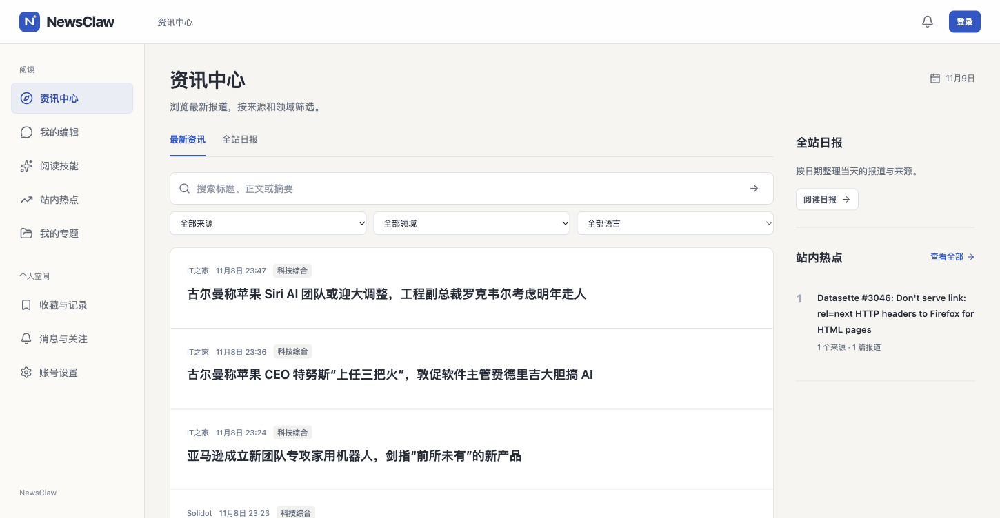

# NewsClaw

个性化 AI 新闻阅读平台。将不同来源的资讯整理到一起，由专属 AI 编辑结合阅读兴趣提供新闻解读、个人日报和持续跟进。

提供可运行的 Web 应用、API 和后台任务。公共新闻供所有人阅读，私人会话、兴趣、记忆和专题按账号保存，生成内容保留来源入口。

## 功能

- **资讯中心**：多来源聚合、筛选、摘要、翻译、事件整理、搜索和收藏，保留报道来源。
- **专属编辑**：带来源的新闻问答、个人日报、长期记忆、编辑手记和站内更新提醒。
- **技能广场**：通俗解读、多源对比、专题简报、思维导图和双语阅读，支持安装、修改、启停与分享。
- **热点与专题**：热点趋势、事件时间线、私人笔记、新闻知识图谱及阅读成果保存与分享。



## 技术选型

- 前端：React Router、TypeScript、Tailwind CSS。
- 后端与数据：Node.js、Fastify、PostgreSQL。
- AI 与运行：远程模型 API、MCP 工具、Redis + BullMQ 后台任务、Docker Compose。

## 项目文档

| 内容 | 入口 |
| --- | --- |
| 使用、运行与模块说明 | [文档导航](docs/README.md) |
| 架构与数据关系 | [系统架构](docs/architecture.md) |
| 业务约定与阶段变更 | [现行规格](openspec/specs/)、[变更目录](openspec/changes/) |
| 开发规则与流程 | [AGENTS.md](AGENTS.md)、[开发指南](CONTRIBUTING.md) |
| 自动检查与正式记录 | [检查入口](docs/verification/checks.md)、[报告索引](reports/README.md) |

## 运行

准备 Docker Compose；本地开发另需 Node.js 24 或更新版本。克隆后复制配置示例，填写数据库口令、对话及嵌入服务配置：

```sh
git clone https://github.com/kmsgk0/newsclaw.git
cd newsclaw
cp .env.example .env
# 填写 .env 中的服务地址、模型名称与凭据
docker compose up --build -d
```

打开 `http://localhost:3100`，接口文档位于 `/docs/api`。注册后会建立自己的编辑。需要管理公共内容时，在已注册账号上执行管理员初始化，方法见[账号说明](docs/modules/account.md)。信源可在管理工作台配置、启停和主动采集，首次初始化也可运行 `npm run seed`。

本地开发：

```sh
npm ci
docker compose up -d db redis
npm run migrate
npm run seed
npm run dev
```

另开终端运行 `npm run worker` 和 `npm run dev:web`，开发网页使用 `http://localhost:5175`。配置、任务调度、错误及恢复见[运行说明](docs/runtime.md)，阅读与页面操作见[界面说明](docs/usage.md)。

## 检查与报告

```sh
npm run lint
npm run typecheck
npm test
npm run test:api
npm run build
npx playwright install chromium --only-shell
npm run test:e2e
```

自动测试使用独立 PostgreSQL 数据库、Redis 队列及模型和信源替身，不调用真实模型。测试账号需能够创建临时数据库。完整入口 `make check` 先执行仓库与安全检查，再运行上述应用检查。单独的 `npm run check -- --base main` 保持仓库检查范围，需先按[检查说明](docs/verification/checks.md)准备 Gitleaks。

[检查报告](reports/README.md)汇总安全、权限、并发、事务和异步结果；[代码审查](docs/verification/code-review.md)列明文件检查与待修改项；[AI 评测](docs/verification/ai-results.md)记录样例输出与内容质量。源码与运行依赖见[依赖说明](docs/dependencies.md)。

## 协作

按[开发指南](CONTRIBUTING.md)准备规约、完成实现和验证，并同步任务状态；全部任务完成后整理现行规格与归档材料。提交使用 Conventional Commits，说明改动及对应规约。环境配置、运行数据和生成型测试产物不进入版本管理，依赖锁文件与无密钥配置示例需要保留；任务要求的脱敏评审与运行记录按指定位置保存。
